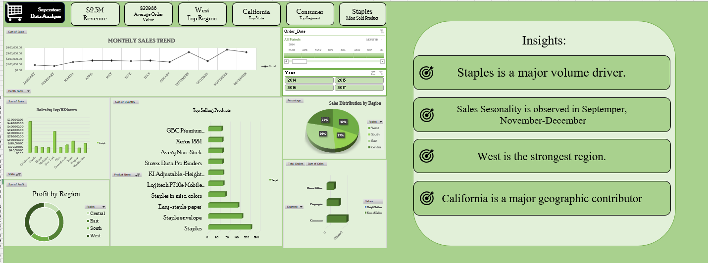
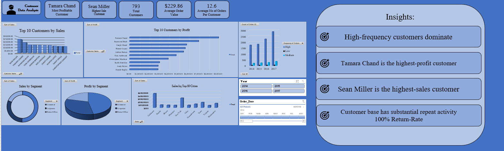
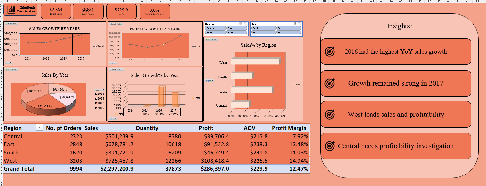

# Superstore Business Analysis | Microsoft Excel

## 1. Project Overview

This project focuses on analyzing Superstore sales data using Microsoft Excel to understand customer behaviour, evaluate sales performance, identify profitable products and categories, and analyze business growth trends.

The project uses Power Query for data preparation, PivotTables for data analysis, and PivotCharts to develop four interactive dashboards covering different aspects of business performance.

Each dashboard includes key performance indicators (KPIs), visualizations, filters and an insights section to present meaningful findings in a structured and visually accessible format.

## 2. Dashboard Screenshots

The project features four dashboards, each designed to provide a different perspective on Superstore business performance.


### 1. Superstore Overview Dashboard

Provides an overall business overview covering revenue, regional performance, top states, best-selling products and sales trends.



### 2. Customer Analysis Dashboard

Analyzes customer purchasing behaviour, customer profitability, order frequency, sales by segment and geographical performance.



### 3. Product & Profitability Analysis Dashboard

Explores product performance, category profitability, sub-category trends, top-selling products and loss-making products.


### 4. Sales Trends Analysis Dashboard

Examines yearly sales and profit growth, regional contributions, sales distribution and historical business performance.



## 3. Project Objectives

- Analyze customer purchasing behaviour and identify high-value customers.
- Evaluate overall sales, revenue and order performance.
- Identify top-performing and least-profitable products.
- Analyze profitability across product categories and sub-categories.
- Compare sales and profit performance across geographical regions.
- Identify yearly and monthly sales trends.
- Develop interactive dashboards to communicate business insights.
- Transform raw business data into meaningful information for decision-making.

## 4. Tools & Technologies

| Tool / Feature | Application |
|---|---|
| Microsoft Excel | Data analysis and dashboard development |
| Power Query | Data importing, cleaning and transformation |
| PivotTables | Data summarization and analysis |
| PivotCharts | Visual representation of analytical findings |
| Excel Slicers | Interactive filtering and data exploration |
| Timeline | Date-based filtering and analysis |
| Excel Formulas & Functions | Calculations and KPI reporting |
| Dashboard Design | Business intelligence and data storytelling |

## 5. Project Workflow

### Step 1: Data Preparation
- Imported and prepared the Superstore dataset.
- Used Power Query for data cleaning and transformation.
- Organized the data for further analysis.

### Step 2: Data Analysis
- Created PivotTables to summarize and analyze business data.
- Analyzed customer, sales, product and profitability metrics.
- Identified important business performance indicators.

### Step 3: Dashboard Development
- Developed four separate dashboards, each focusing on a different analytical area.
- Used PivotCharts to visualize summarized data.
- Incorporated KPIs, slicers and timelines for interactive exploration.
- Added dedicated insights sections to highlight important findings.

### Step 4: Data Visualization
- Presented business metrics through charts and visual summaries.
- Compared performance across different business dimensions.
- Highlighted customer patterns, product performance, profitability and sales trends.

## 6. Dashboard Breakdown

The project consists of four dashboards covering different dimensions of Superstore business performance.

### Dashboard 1: Customer Analysis

**Objective:** Understand customer purchasing behaviour, identify valuable customers and analyze customer engagement.

**Key Metrics:**
- Total Customers: 793
- Average Order Value: $229.86
- Average Number of Orders per Customer: 12.6
- Most Profitable Customer: Tamara Chand
- Highest Sales Customer: Sean Miller

**Analysis Includes:**
- Top 10 Customers by Sales
- Top 10 Customers by Profit
- Customer Order Frequency Analysis
- Sales by Segment
- Profit by Segment
- Sales by Top 10 Cities

**Key Insights:**
- High-frequency customers dominate purchasing activity.
- Tamara Chand is the highest-profit customer.
- Sean Miller is the highest-sales customer.
- The dashboard reports a 100% customer return rate.

### Dashboard 2: Superstore Overview

**Objective:** Provide an overall view of business performance, revenue distribution and major contributors to sales.

**Key Metrics:**
- Total Revenue: Approximately $2.3 Million
- Average Order Value: $229.86
- Top Region: West
- Top State: California
- Top Segment: Consumer
- Most Sold Product: Staples

**Analysis Includes:**
- Monthly Sales Trends
- Sales by Top 10 States
- Top Selling Products
- Sales Distribution by Region
- Profit by Region
- Regional Order and Sales Distribution

**Key Insights:**
- Staples is a major sales volume driver.
- Sales seasonality is observed in September and November–December.
- West is the strongest region.
- California is a major geographical contributor.

### Dashboard 3: Product & Profitability Analysis

**Objective:** Evaluate product performance and identify the most profitable and least profitable products, categories and sub-categories.

**Key Metrics:**
- Highest Sales Product: GBC DocuBind P400 Electric Binding System
- Most Sold Product: Staples
- Highest Performing Category: Technology
- Highest Selling Sub-category: Phones
- Most Profitable Sub-category: Copiers
- Least Profitable Product: Cubify CubeX 3D Printer Double Head Print

**Analysis Includes:**
- Top 10 Products by Profit
- Profit by Sub-category
- Bottom 10 Products by Profit
- Profit by Category
- Top 10 Products by Quantity
- Top 10 Products by Sales

**Key Insights:**
- Technology is the strongest selling category.
- Phones are the strongest selling sub-category.
- Copiers stand out in profitability.
- Tables are the most loss-making sub-category.

### Dashboard 4: Sales Trends Analysis

**Objective:** Analyze historical sales growth, profitability trends and regional performance over multiple years.

**Key Metrics:**
- Total Sales: $2,297,200.90
- Total Orders: 9,994
- Average Order Value: $229.90
- Analysis Period: 2014–2017

**Analysis Includes:**
- Sales Growth by Year
- Profit Growth by Year
- Sales by Year
- Sales Growth Percentage by Year
- Sales Distribution by Region
- Regional Sales and Profitability Comparison

**Key Insights:**
- 2016 recorded the highest year-over-year sales growth.
- Sales growth remained strong in 2017.
- West leads in sales and profitability.
- Central requires further profitability investigation.

## 7. PivotTable Organization

The workbook uses two separate PivotTable sheets to support all four dashboards.

**PivotTable Sheet 1 – Customer Analysis**
- Contains the supporting PivotTables for the Customer Analysis dashboard.

**PivotTable Sheet 2 – Supporting Dashboard Analysis**
- Contains the supporting PivotTables for the Superstore Overview, Product & Profitability, and Sales Trends dashboards.

**Design Decision:**

The PivotTable analysis was divided into two sheets to avoid overcrowding and maintain an organized workbook structure.

The first sheet is dedicated to the Customer Analysis dashboard, while the second consolidates the analytical data required for the remaining three dashboards.

This approach improves workbook organization and makes the supporting analysis easier to maintain.

## 8. Key Skills Demonstrated

- Data Cleaning and Preparation
- Power Query
- Exploratory Data Analysis (EDA)
- Data Summarization
- PivotTable Analysis
- PivotChart Development
- Customer Behaviour Analysis
- Sales and Revenue Analysis
- Product Profitability Analysis
- Trend Analysis
- KPI Reporting
- Interactive Dashboard Development
- Data Visualization
- Business Intelligence
- Data Storytelling

## 9. Key Project Highlights

- Developed four dashboards covering different business analytical dimensions.
- Analyzed customer purchasing patterns and profitability.
- Evaluated product and sub-category performance.
- Compared sales and profitability across geographical regions.
- Analyzed historical sales and profit trends from 2014 to 2017.
- Used interactive filters and timelines for dynamic data exploration.
- Designed dedicated insights panels to communicate analytical findings.
- Organized supporting PivotTables across two separate sheets for better maintainability.

## 10. Repository Structure

```text
Superstore-Business-Analysis/
│
├── Superstore_Analysis.xlsx
│
├── Screenshots/
│   ├── Overview_SuperstoreProject.png
│   ├── CustomerAnalysis_SuperstoreProject.png
│   ├── ProductAnalysis_SuperstoreProject.png
│   └── SalesAnalysis_SuperstoreProject.png
│
└── README.md
```

## 11. Project Conclusion

This project demonstrates the practical application of Microsoft Excel and Power Query in business data analysis.

By combining data preparation, PivotTable analysis, interactive dashboards and business insights, the project transforms raw Superstore data into a structured business intelligence solution.

It provides an analytical view of customer behaviour, sales performance, product profitability and regional business trends.

---

**Project Category:** Data Analytics | Business Intelligence

**Tools Used:** Microsoft Excel | Power Query | Power Pivot

**Analysis Period:** 2014–2017

**Total Dashboards:** 4

**Supporting PivotTable Sheets:** 2

**Author:** Ziya
